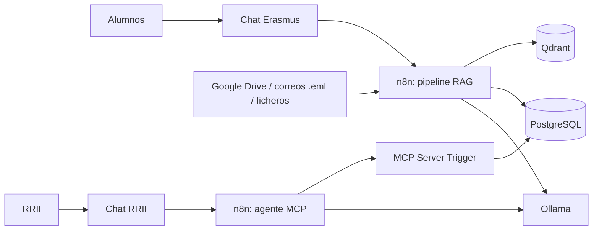

# Erasmus RAG Chatbot

**TFG 9,90/10 · Universidad de Huelva · 2026**

Ecosistema de chatbots para la gestión del programa Erasmus+ en la Universidad de Huelva. Combina un asistente **RAG** para estudiantes y un agente **MCP** para el personal de la Oficina de Relaciones Internacionales (ORI).

El sistema se desplegó en un servidor universitario con GPU y se validó con la ORI para dos tipos de usuario: estudiantes y personal administrativo.

> Repositorio de entrega del TFG. Los workflows de n8n se exportan en `n8n/`; el resto de carpetas son puntos de entrada para documentos y correos.

## Qué hace

### Chat Erasmus (alumnos)

- Consulta la documentación oficial del programa Erasmus+ en lenguaje natural.
- Recupera fragmentos de documentos indexados (PDF, DOCX, EML y XLSX) y responde con un LLM local.
- Si el caso necesita intervención humana, recoge los datos con un formulario y avisa a la ORI por correo.
- Incluye conversión de divisas mediante una herramienta MCP.

### Chat RRII (secretaría)

- Agente MCP para consultar la base de datos operacional en lenguaje natural.
- Responde sobre tickets pendientes, historial de conversaciones y ficheros procesados.
- Usa herramientas MCP para ejecutar consultas SQL en PostgreSQL y consultar la fecha.

## Arquitectura



### Pipeline RAG

1. **Ingesta:** Google Drive, correos .eml y ficheros locales; extracción de PDF, DOCX, EML y XLSX.
2. **Preparación:** limpieza, chunking recursivo y cálculo de hash para evitar duplicados.
3. **Indexación:** embeddings con Ollama y almacenamiento en Qdrant; reindexado cuando cambia la documentación.
4. **Consulta:** clasificador de entrada, recuperación semántica en Qdrant, reranking con Cohere y respuesta con un LLM local.
5. **Escalado:** si el alumno necesita ayuda humana, un formulario recoge el caso y se notifica a la ORI.

### Agente MCP

1. El chat recibe la pregunta y mantiene memoria de la conversación.
2. Un `MCP Server Trigger` expone las herramientas del agente.
3. Las herramientas permiten consultar PostgreSQL y la fecha/hora.
4. El agente traduce la pregunta a consultas SQL sobre tickets, conversaciones y ficheros.

## Stack

| Área | Tecnología |
|---|---|
| Orquestación | n8n |
| LLM y embeddings | Ollama (modelos locales); OpenRouter en un nodo auxiliar del workflow |
| Base vectorial | Qdrant |
| Base relacional | PostgreSQL |
| Ingesta | Google Drive, correos .eml, ficheros locales; PDF, DOCX, EML, XLSX |
| Reranking | Cohere |
| Infraestructura | Docker Compose (perfiles `cpu`, `gpu-nvidia`, `gpu-amd`) |
| Administración | pgweb, Adminer |

## Instalación

```bash
git clone https://github.com/jjrmch/erasmus-rag-chatbot.git
cd erasmus-rag-chatbot
cp .env.example .env        # Rellenar con tus credenciales
docker compose --profile cpu up -d   # o gpu-nvidia / gpu-amd
```

## Acceso

| Servicio | URL |
|----------|-----|
| n8n | http://localhost:5678 |
| Qdrant | http://localhost:6333 |
| pgweb | http://localhost:8081 |
| Adminer | http://localhost:8080 |

## Configuración

Copia `.env.example` como `.env` y ajusta los valores. Los workflows de n8n necesitan credenciales de Google Drive para la ingesta y de Gmail para las notificaciones, además de acceso a PostgreSQL, Qdrant y Ollama.

> Las carpetas `shared/`, `correos_descartados/` y `procesar_sin_comprobar/` contienen un `.gitkeep` para que Git las rastree. Elimínalos con `find . -name ".gitkeep" -delete` antes de añadir contenido real.

## Estructura

```text
.
├── docker-compose.yml
├── .env.example
├── n8n/
│   ├── chatbot alumnos.json
│   └── chatbot RRII.json
├── shared/                  # documentación compartida para indexar
├── correos_descartados/     # correos descartados por el clasificador
└── procesar_sin_comprobar/  # ficheros pendientes de revisión
```

## Resultados

- **Calificación:** 9,90/10 en el TFG de Ingeniería Informática (Universidad de Huelva, 2026).
- **Despliegue:** servidor universitario con GPU.
- **Validación:** Oficina de Relaciones Internacionales, con estudiantes y personal administrativo.
- **Uso:** dos chatbots complementarios sobre la misma base documental y operativa.

## Seguridad y privacidad

- **LLM local:** los modelos principales y los embeddings se ejecutan con Ollama en el servidor. El workflow incluye un nodo auxiliar de OpenRouter; para un pipeline 100 % local habría que eliminarlo.
- **Datos:** la documentación y las conversaciones viven en PostgreSQL y Qdrant del entorno universitario.
- **Acceso:** el chat de RRII está pensado para personal interno; conviene revisar y documentar la autenticación del acceso.
- **Riesgos a cubrir:** prompt injection a través de documentos o correos, permisos de la herramienta SQL, datos personales en conversaciones y retención de logs.

## Limitaciones y mejoras

- El repositorio no incluye una evaluación formal de retrieval (faithfulness, relevance); la validación documentada fue cualitativa con la ORI.
- Los workflows de n8n no tienen tests automatizados ni CI.
- La autenticación y autorización del chat de RRII están pendientes de revisar.
- Faltan métricas, trazas y alertas de observabilidad.
- La ingesta depende de credenciales de Google y de la estructura de carpetas; se puede hacer más idempotente.
- El pipeline se puede simplificar y documentar mejor para que otra persona lo despliegue sin ayuda.

## Qué aprendí

- Un RAG es mucho más que el modelo: la ingesta, el chunking, el retrieval y el reranking deciden la calidad.
- Validar con usuarios reales desde el principio evita construir respuestas que nadie necesita.
- La seguridad y la privacidad hay que diseñarlas desde el inicio: LLM local, permisos mínimos para las herramientas y cuidado con los datos que se indexan.

## Autor

**Jaime José Romero Molina** — Graduado en Ingeniería Informática (Computación), Universidad de Huelva, 2026.
